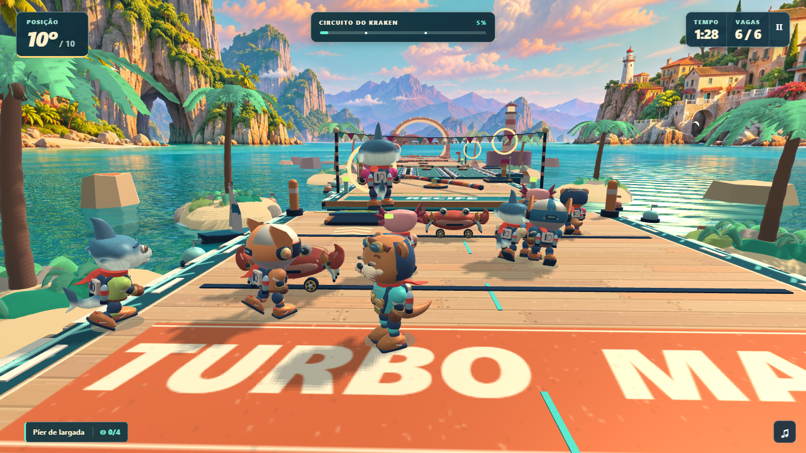

# Turbo Maré

Uma corrida 3D pelo Circuito do Kraken. Dez pilotos largam em um píer tropical. Os seis primeiros a cruzar a linha de chegada em até 90 segundos se classificam. O navegador simula os nove adversários, os trampolins, as hélices e os tentáculos.



## Jogar

[**Abrir o Turbo Maré no navegador**](https://alexandremocmg.github.io/turbo_mare/)

Para instalar, abra o link no Chrome ou Edge e use **Instalar jogo** quando aparecer. No iPhone ou iPad, abra no Safari e escolha **Compartilhar → Adicionar à Tela de Início**. Se aparecer **Abrir como App**, deixe essa opção ativada. No primeiro acesso com internet, espere o menu mostrar **Pronto para jogar offline** antes de desconectar.

[Baixe o jogo em um único arquivo HTML](https://raw.githubusercontent.com/Alexandremocmg/turbo_mare/main/index.html). Se o navegador exibir o código, salve a página como `index.html` e abra o arquivo baixado. Você também pode clonar o repositório e abrir o `index.html` da raiz. A arte e o áudio funcionam offline em um navegador com WebGL.

- **Disputar corrida** coloca você no grid com mais nove pilotos. Os quatro anéis dão impulso e os checkpoints encurtam o retorno após uma queda.
- **Treino livre** abre a pista para uma volta solo, sem limite de tempo.
- **Pilotos** permite girar o modelo por arraste, experimentar quatro animações e escolher Lontra, Tubarão, Axolote ou Marujo.

| Ação | Computador | Tela de toque |
| --- | --- | --- |
| Mover | WASD ou setas | Controle direcional à esquerda |
| Pular | Espaço | Pulo |
| Mergulhar | Shift | Mergulho |
| Pausar | Esc | Botão de pausa |
| Reiniciar | R durante a corrida | Pausa → Reiniciar |

## Desenvolver

Os fontes editáveis ficam em [src](src/). Para ver uma alteração imediatamente, sirva essa pasta por HTTP. Com Python 3 instalado, execute o comando abaixo na raiz e abra `http://localhost:8000`. Em um Codespace, abra a prévia da porta 8000.

```sh
python -m http.server 8000 --bind 127.0.0.1 --directory src
```

Para atualizar a versão distribuída e testar a física, use Node.js 24. Os scripts usam apenas módulos nativos.

```sh
node scripts/build.cjs
node scripts/build.cjs --check
node --test tests/corrida.test.cjs tests/kraken.test.cjs
```

O [guia de desenvolvimento](docs/DESENVOLVIMENTO.md) mostra onde mudar a pista, os modelos e as animações, e como repetir o teste no navegador. A [galeria](docs/GALERIA.md) reúne os quatro pilotos, o menu e a corrida em tela de toque.
