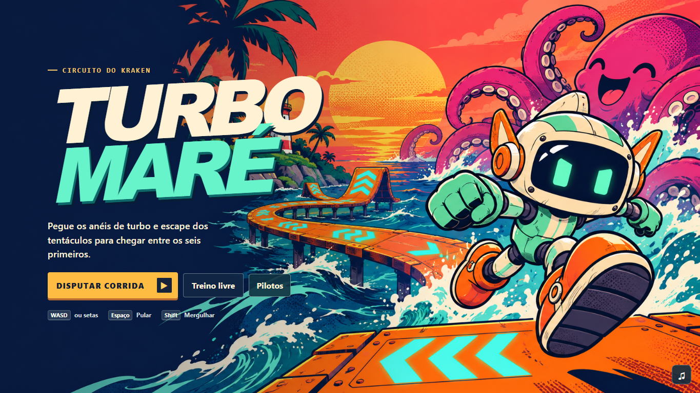
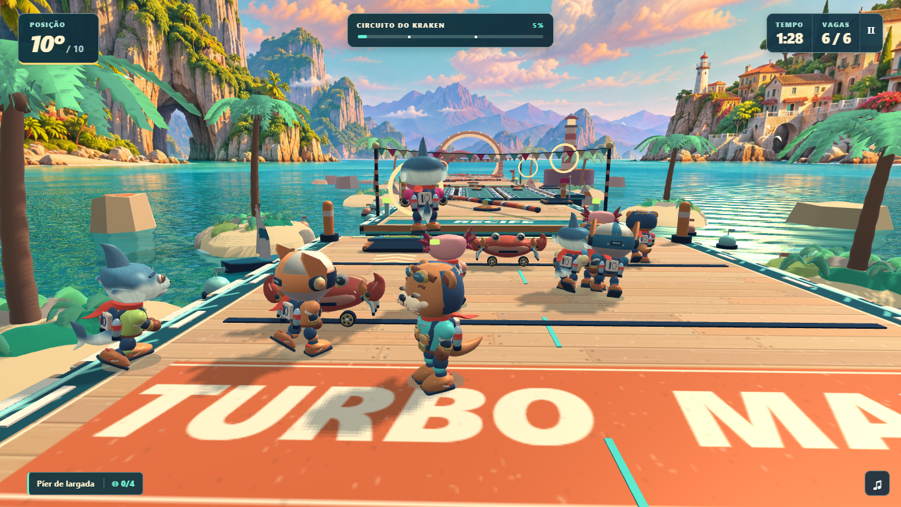
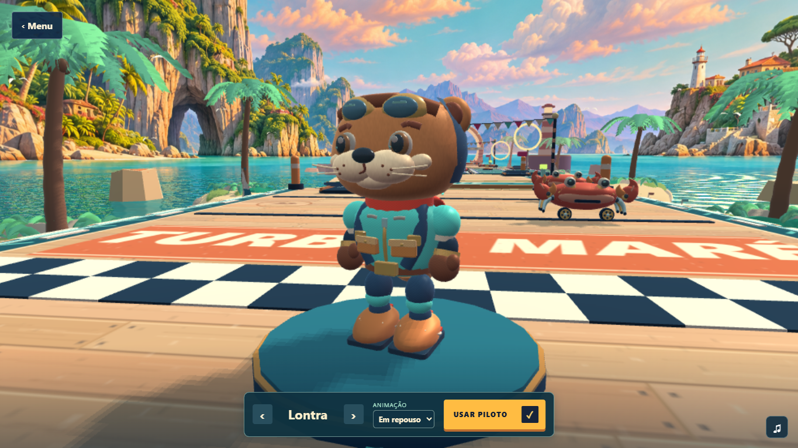
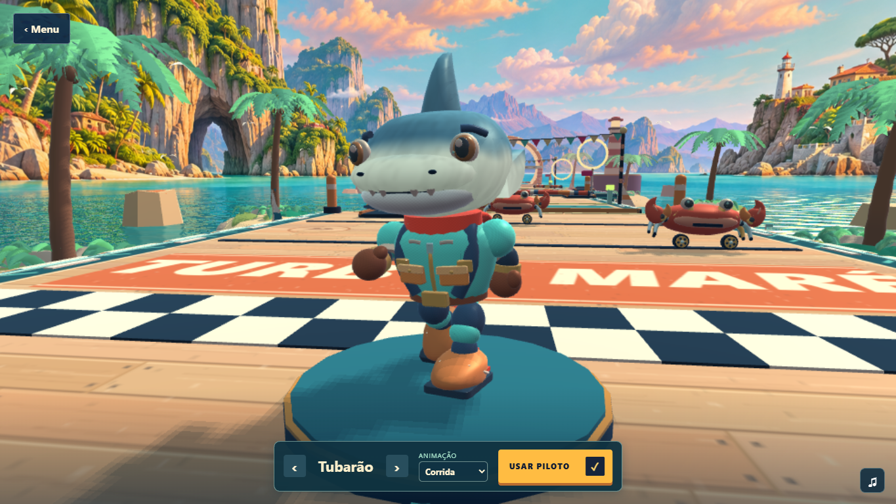
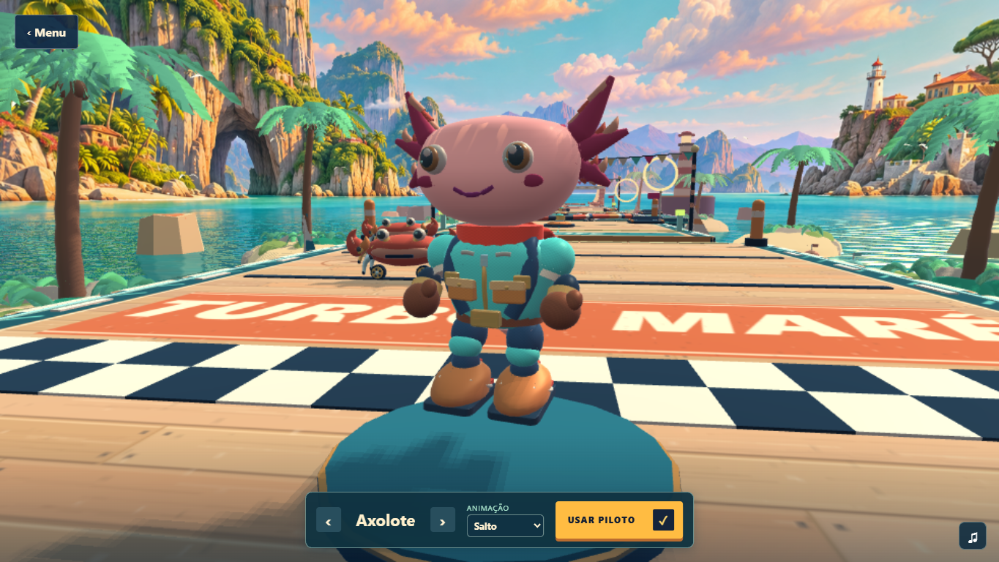
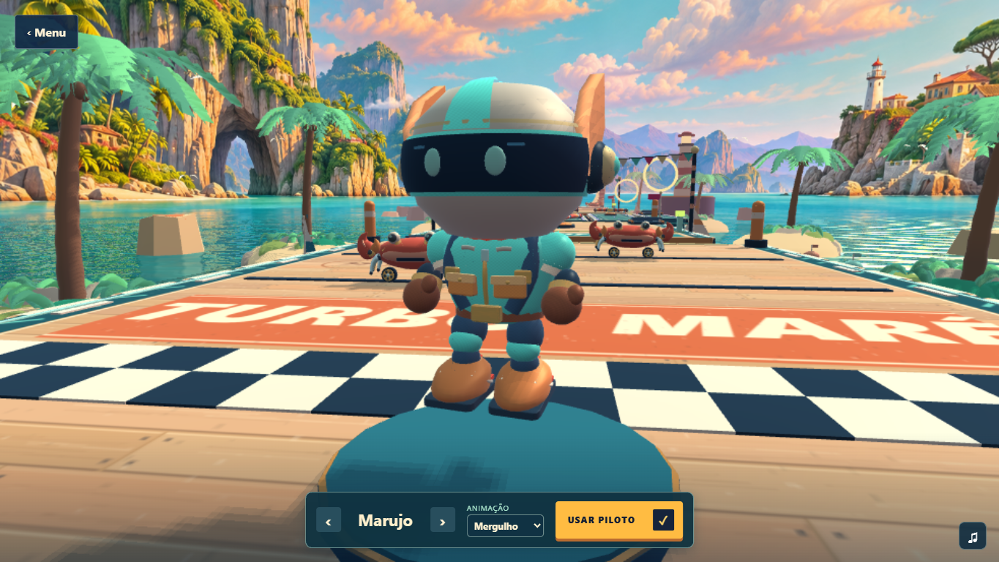
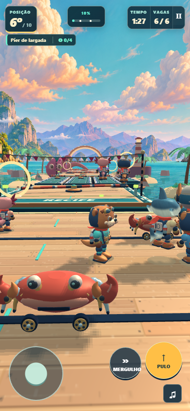

# Galeria do Circuito do Kraken

Capturas do próprio jogo. Para repetir um enquadramento no seletor, abra **Pilotos**, arraste o personagem para girá-lo e escolha a animação no rodapé.

## Menu e corrida

## Pilotos

| Lontra | Tubarão |
| --- | --- |
|  |  |
| **Axolote** | **Marujo** |
|  |  |

## Controles de toque

